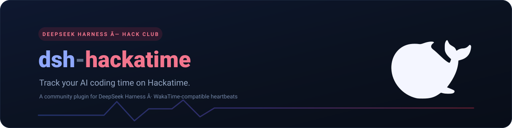
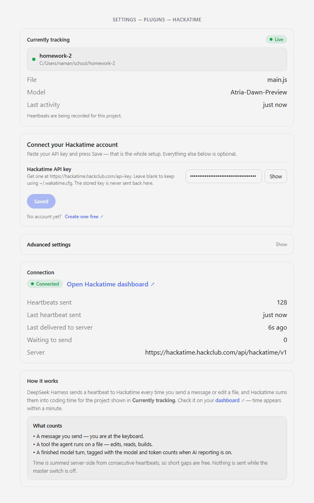
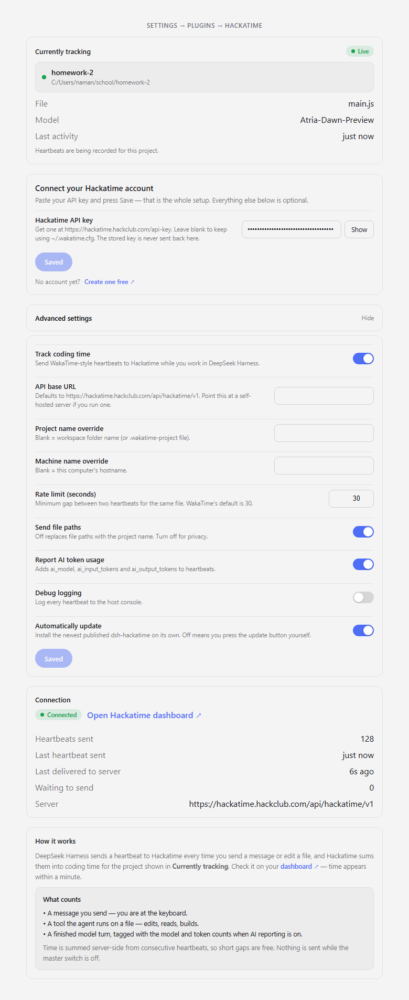

<p align="center">
  
</p>

# dsh-hackatime

[](https://www.npmjs.com/package/dsh-hackatime)
[](./LICENSE)
[](https://github.com/namandhakad712/dsh-hackatime)
[](https://hackatime.hackclub.com)

Track the time you spend in [DeepSeek Harness](https://github.com/deepseek-ai/DeepSeek-AS-Review) as coding time on [Hackatime](https://hackatime.hackclub.com). If DSH is your daily driver but your leaderboard only sees your editor time, this closes the gap: it sends [WakaTime-style heartbeats](https://hackatime.hackclub.com/api-docs) for the files you and the agent work on, so agent-driven coding counts too.

Never installed a DSH plugin before? The [full walkthrough](docs/INSTALL.md) covers every step, including what to do when nothing shows up.

## Features

- **Zero configuration if you already track with WakaTime or Hackatime.** The plugin reads `api_url` and `api_key` straight from `~/.wakatime.cfg` and re-reads it only when the file changes.
- **Live answer to "is it actually tracking me?"** The settings card names the project being timed right now, with a Live/Idle pill, the file, the model, and the last activity.
- **Tracked as AI Coding.** Every heartbeat carries `category: "ai coding"` — Hackatime's category for agent-driven work — so your DSH time shows up under AI Coding, not blended into hand-edited time.
- **Built to count on Hackatime.** Every heartbeat reports `editor: DeepSeek Harness` — never a browser name — so your time stays leaderboard-eligible.
- **Offline-safe.** Heartbeats are queued in memory and retried with backoff; a dropped Wi‑Fi connection costs no tracked time.
- **Private by choice.** File paths are sent by default and can be switched off with one toggle. Your API key is stored as a secret and never logged. No analytics, no telemetry.
- **AI-aware.** Model turns are tagged with `ai_model`, `ai_input_tokens` and `ai_output_tokens`, so Hackatime's AI leaderboards see your agent work too.
- **Self-updating.** A newer published version installs itself (you can turn that off and press the update button yourself).
- **Works with any WakaTime-compatible server**, not just Hackatime — point `apiUrl` wherever you like.

## Install

You need [DeepSeek Harness](https://github.com/deepseek-ai/DeepSeek-AS-Review) 0.1.6 or newer for the settings card. On older builds the card falls back to a legacy slot and the config still works through the profile's `cordis.patch.yml`.

1. Install the plugin:

   ```sh
   dsh plugin add dsh-hackatime
   ```

   Add `--profile <name>` if you run a non-default profile.

2. **Restart DSH.** Plugin bundles load at startup.
3. Open **Settings → Plugins → Hackatime**.
4. Paste your API key from <https://hackatime.hackclub.com/api-key> and press **Save**.
5. Start coding. Time lands on your [dashboard](https://hackatime.hackclub.com) within about a minute.

## The settings card



*The card opens onboarding-first: what's being tracked right now, then the one field a new user needs. The numbered steps disappear once a key is saved.*

Behind the **Advanced settings** disclosure is everything else — the master switch, server URL, project and machine overrides, the heartbeat rate limit, and the privacy and update toggles — with its own Save button.



## Configure

With no configuration at all, the plugin reads `~/.wakatime.cfg`:

```ini
[settings]
api_url = https://hackatime.hackclub.com/api/hackatime/v1
api_key = your-key-here
```

Everything can also be set on the card. Fields on the card win over the file.

| Field | Default | Meaning |
| --- | --- | --- |
| `enabled` | `true` | Master switch. No heartbeats are recorded or sent while off. |
| `apiKey` | _(from `~/.wakatime.cfg`)_ | Hackatime API key. Stored as a secret, never logged. Get one at <https://hackatime.hackclub.com/api-key>. |
| `apiUrl` | `https://hackatime.hackclub.com/api/hackatime/v1` | API base URL. Point this at a self-hosted WakaTime-compatible server if you run one. |
| `project` | _(workspace folder name)_ | Project name override. A `.wakatime-project` file in the workspace root wins over this. |
| `machine` | _(hostname)_ | Machine name override. |
| `rateLimitSeconds` | `30` | Minimum gap between two heartbeats for the same file. WakaTime's own default. |
| `sendEntityPath` | `true` | Send the full file path as `entity`. Turn off for privacy — only the workspace folder name is sent. |
| `sendAiUsage` | `true` | Attach `ai_model`, `ai_input_tokens` and `ai_output_tokens` to heartbeats that carry them. |
| `debug` | `false` | Log every heartbeat to the host console. |
| `autoUpdate` | `true` | Install the newest published `dsh-hackatime` automatically. Turn off to update manually from the settings card. |

## What gets recorded

| Activity | Heartbeat |
| --- | --- |
| You send a message | one, `is_write: false` |
| The agent calls a tool on a file | one, `is_write: true` for write tools |
| A tool call returns | one, `is_write` inherited from the call |
| The assistant finishes a turn with token usage | one, tagged with AI usage |

Write tools are detected by name (`write`, `edit`, `str_replace_editor`, `apply_patch`, `create_file`, and similar). Read-only tools like `read`, `glob` and `grep` only produce a heartbeat when their result comes back, so listing a file never looks like editing it. Language is inferred from the file extension (`.js` → `JavaScript`, `Dockerfile` → `Dockerfile`); unknown extensions are left to the server.

A few details that are taken from the Hackatime server source rather than guessed:

- `time` is Unix epoch **seconds** (the server rejects anything outside `1000000000`–`2000000000`).
- `category` is always `coding`, and `editor` is always `DeepSeek Harness` — never a browser name, so the time counts on the leaderboard.
- `project` is never the `<>` sentinel WakaTime uses for "same as last heartbeat".
- `user_agent` is the bare token `dsh`. Anything slash-separated gets parsed by Hackatime's user-agent parser, whose extracted editor overrides the explicit `editor` field — and `dsh-hackatime` matches the parser's plugin pattern, which would strip it to `dsh`. A bare token parses blank, so the explicit editor survives.

## Privacy

- Your API key is stored with the `secret` role, is never logged, and is **write-only over the plugin's RPC channel** — the settings card never receives the stored value back, it only knows whether one is set. See [SECURITY.md](SECURITY.md) for the full trust model.
- The settings card's RPC route is authenticated with the same browser-session gate dsh uses for its own API, so no other process on your machine can read your config or re-point it.
- File paths are sent as the `entity` field by default. Turn **Send file paths** off and only the workspace folder name leaves your machine.
- No file contents are ever sent — only paths, timestamps, and language metadata.
- There is no analytics or telemetry. The only traffic is the heartbeats you configure, plus a version check against the npm registry to power the update notice.

## Uninstall

```sh
dsh plugin remove dsh-hackatime
```

## Status

**This is an independent community plugin, not an officially recognized one.** It is not certified by Hack Club yet, so Hackatime may not count time from it toward programs or leaderboards until it is. Certification is being pursued. If that matters to you, wait for certification before relying on it.

## License

MIT

## Status
